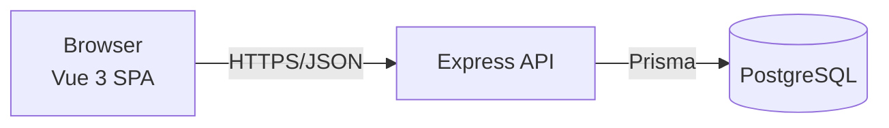
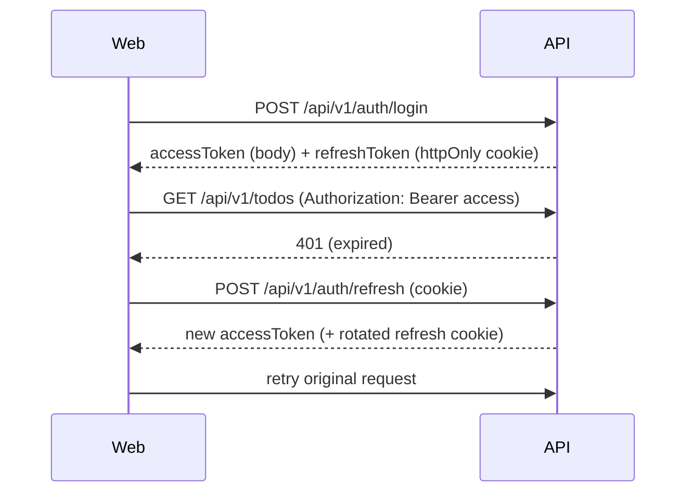

# Architecture

## Overview


## Monorepo
pnpm workspaces:
```
apps/api        Express backend
apps/web        Vue 3 frontend
packages/shared Zod schemas + inferred TS types (DTOs), used by api & web
```

## Backend Layers (`apps/api/src`)
```
app.ts                 # express app factory (no listen) → testable
server.ts              # listen()
config/env.ts          # Zod-validated env vars
routes/                # route definitions, attach middleware
controllers/           # HTTP in/out only, no business logic
services/              # business logic
repositories/          # Prisma access only
middlewares/           # auth, validate, errorHandler, rateLimit
errors/                # AppError classes
lib/prisma.ts          # PrismaClient singleton
```
Flow: `route → validate(zod) → auth → controller → service → repository → prisma`.

Rules:
- Controllers never import Prisma.
- Services throw `AppError` subclasses; `errorHandler` maps them to the format in [API_SPEC.md](API_SPEC.md).

## Frontend (`apps/web/src`)
See [FRONTEND.md](FRONTEND.md).

## Auth Flow

- Access token: 15 min, kept in memory (Pinia).
- Refresh token: 7 days, httpOnly + Secure + SameSite=Strict cookie, stored hashed in DB, rotated on use.

## Environments
| Env | DB | Notes |
|---|---|---|
| local | docker compose | `.env` |
| test | separate DB `todo_test` | reset per test run |
